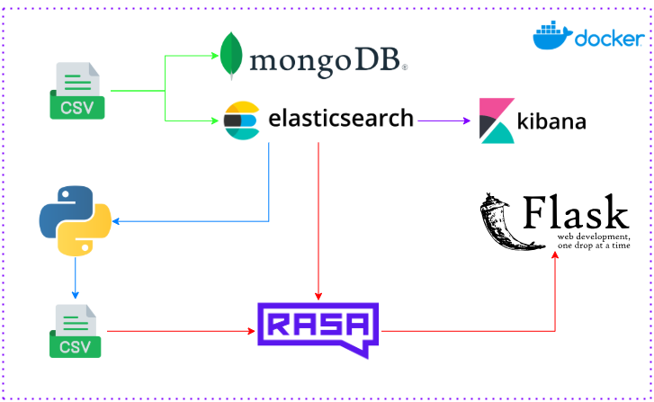
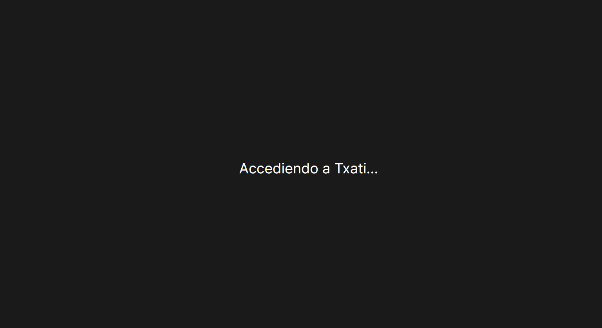

# Data Orchestrator

Data Orchestrator automates the ingestion of taxi data from a CSV into MongoDB (backup) and Elasticsearch (primary). It integrates a Rasa chatbot that answers questions by distinguishing between common ones (responses taken from a CSV) and uncommon ones (direct queries to Elasticsearch), and provides a Flask-based web interface.

## Main features

- [Automatic CSV ingestion](ingestion/src/load_data.py) → MongoDB and Elasticsearch.

- Kibana for graphical queries against Elasticsearch.

- [Common Questions API](apis/common_questions_api.py) performs common queries to Elasticsearch every 5 minutes and saves the answers into another CSV.

- [Rasa chatbot](chatbot/actions/actions.py) that replies depending on whether the question is a common one or not.

- [Flask web interface](chatbot/app.py) to interact with the chatbot.

## Authors

This project was developed by Sergio González, Jose María Martín, Juan Pérez and Mario Gutiérrez.

## Architecture



## Deployment with Docker

1. Clone the repository and go to the `deployment` folder
```bash
git clone https://github.com/maariogutierrez/data-orchestrator.git
cd data-orchestrator/deployment
```

2. Run Docker Compose:

```bash
docker-compose up -d
```

3. Wait for all services to start.

```bash
docker ps
docker logs -f <chatbot container id>
```

The service is ready when you see the log message:

```bash
Servidor RASA iniciado ✅
```

4. Access the chatbot interface at: http://127.0.0.1:8001

[](https://youtu.be/N2D1xSq7qSE?si=4YLaqi-P5IOD6SC5)

## License

This project is licensed under the MIT License — see the `LICENSE` file for details.
